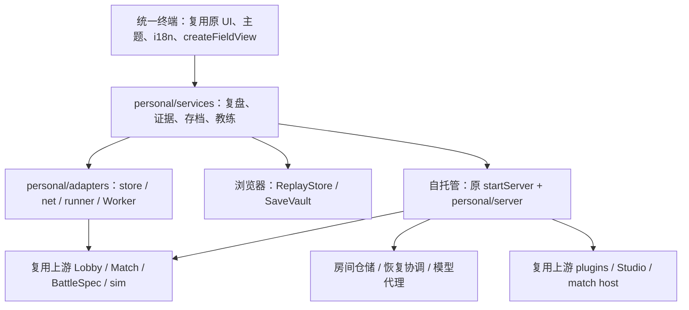

# Stronghold Protocol: Alliance — Enhanced Edition：下一阶段技术设计

状态：提案，供实现前评审；2026-10-30。依据当前 main `9a96d85` 与上游 master `f07b896`。本轮只新增文档和审计证据，没有改变游戏实现或生产站点。

English overview: This is an unofficial enhanced fan edition of Arknights: Stronghold Protocol — Alliance, derived from sganggs/Stronghold-Protocol. Preserve upstream gameplay, authorship, plugins, Studio and AI teammates. The proposal adds an integrated tactical terminal, evidence-linked coaching, verified save migrations and self-hosted room persistence in the personal layer. Production deployment requires explicit approval.

配套：[差异审计](ENHANCED-AUDIT.zh-CN.md) · [风险清单](ENHANCED-RISKS.zh-CN.md) · [优先级和验收](ENHANCED-PLAN.zh-CN.md)。

## 1. 定位、目标与约束

保留「卫戍协议：盟约 / Stronghold Protocol: Alliance」名称、原规则和上游署名；Enhanced Edition 是增强版本标识，不把作品改称独立原创游戏。基于上游已有实现发展个人版功能。

本阶段四项设计目标：统一战术终端；能点击证据核查的战术教练 2.0；可验证、可回退的 PREP 存档迁移；可自托管的多人房间持久化。先修正数据质量和兼容身份，再在其上提供可信 UI 和建议。

不重写插件系统、Studio、干员、战斗引擎、AI 队友；不新增原站账号同步；不承诺任意帧存档、跨规则无损迁移、多人高可用集群或模型自动指挥。自定义挑战继续作为明确标识的可选规则，默认对局保持原版兼容。

## 2. 分层和复用边界



上述目录为建议的渐进拆分，现有模块可以先保留文件名，通过导出接口收敛依赖；不为改目录进行大规模重写。

| 接口（提案） | 职责 | 约束 |
| --- | --- | --- |
| `GameAdapter` | 提供路由、模式、官方版本、阶段、玩家范围和规范化事件；申请/释放本地暂停 | UI 不直接改 Match 或发送任意底层命令；一个适配器集中跟踪上游接口 |
| `CapabilityService` | 汇总本地构建能力及后端握手能力 | 单独声明 reconnect、durableRooms、Studio、replayCoverage、coach；不能用静态 healthz 推断服务器存在 |
| `ReplayRepository` | 持久化、查询、导入、导出、完整性检查 | 追加数据有序；旧 partial 写入不能覆盖更新的 final 记录；读写失败可见 |
| `EvidenceService` | 从记录生成有来源的事实、度量与可比性结果 | 区分未知和零；禁止跨玩家隐式回退 |
| `SaveService` | 验证、试迁移、试恢复、激活、回滚与原文导出 | 失败不改变当前有效存档；本地 PREP 和服务器房间存储分开 |
| `RoomRepository / RecoveryCoordinator` | 房间检查点、会话凭据、恢复代次和结算去重 | 原 Match/子进程仍执行规则；仓储不承担第二套游戏逻辑 |

上游只保留已有两处结果显示修复。新增功能默认放在 personal。若持久化确需原 Lobby/Match 增加生命周期接口，先形成一个小型、可审查的可选 hook 补丁，默认关闭且不改变原调用路径；附上游兼容测试和补丁清单，不复制 Match 类。

建立构建清单，分别记录：personal commit、upstream commit、适配补丁摘要、协议版本、官方 gameVersion、模拟引擎摘要、玩法数据摘要、`cs`/插件集合、`vs`/素材集合。沿用上游已有内容标识；补充缺失身份，不另造插件身份系统。玩法兼容与仅视觉变化分开判定。先验证实际影响再维护兼容矩阵，不能仅凭版本号相近放行。

## 3. 统一战术终端 UI/UX

### 3.1 信息架构和主要流程

沿用原游戏字体、色彩 token、按钮、弹层和 Preact/htm。保留一个“战术终端”入口，在大厅可见；休整提供当前局快捷入口；结算页提供“查看本场复盘”。游戏原有战绩页保留为总战绩入口，链接终端的局部分析，避免新增第二份战绩真相源。

终端四个任务区：

1. **复盘与教练**：按对局→回合→战场选择；时间轴、干员统计、事件列表、建议共用一份 selection。
2. **存档与恢复**：当前可恢复点、备份、导入检查、迁移预览、回滚；醒目说明退出战斗会退回最近休整。
3. **挑战与内容**：本地挑战预设、规则摘要、插件兼容信息；可用时链接原 Studio/插件管理，不再写编辑器。
4. **连接与诊断**：本地/远程模式、后端能力和恢复状态；资源可用性、模型配置和数据导出放在这里。

复盘桌面布局：左侧对局/回合列表，中间原渲染器或示意播放器与时间轴，右侧证据与建议；窄屏在“画面 / 事件 / 分析”间切换，保持同一时间点。教练卡片由“观察事实—可验证假设—下一次单项调整—证据”组成；点击引用选中相关事件、时间窗或结算字段，没有时间证据时只定位统计。

### 3.2 状态与交互规则

- 顶部清楚显示“本地单人 / 服务器联机 / 离线查看”、记录来源、数据完整程度；不可用功能显示具体原因。
- 本地战斗打开终端可申请暂停，关闭仅释放自己持有的暂停；不解除用户原先的暂停。多人打开终端不暂停服务器，不允许据此阻塞结算。
- 恢复时显示校验、试恢复、提交三个步骤；导入不自动替换正在玩的局。迁移不兼容时允许导出原文件。
- 弹层复用焦点管理和 Escape 行为；关闭后焦点回到触发入口；分页支持键盘，错误通过 live region 宣告。建议自动完成不抢走当前焦点。
- 新文案纳入个人层翻译键和原语言选择链路，至少提供中英文；统一主题，不维护第二套固定配色。
- 路由切换、关闭终端、选中另一条记录时取消过期读取/模型请求；按记录 ID 与 revision 丢弃过时响应。

UI 验收包括大厅→休整→战斗→结算、键盘往返、窄屏、语言/主题变化、暂停所有权、后台回到前台、慢请求后切换记录。每项 UI 改动附相应测试，而非只比较截图。

## 4. 复盘契约和带引用的教练 2.0

### 4.1 Replay v2：区分数据来源和质量

建议结构（概念字段，最终 schema 在实现前定稿）：

```text
header: schemaVersion, replayId, runId, battleId, fieldId, officialVersion,
        engineHash, dataHash, cs, vs, rulesDigest, stageId, modeId,
        round, seed, source, perspective, recordedAt
scenario: sanitized BattleSpec + specHash（仅当原协议可获得）
events[]: eventId, streamId, seq, tick?, gt, timePrecision,
          type, actorRef?, targetRef?, payload, source
frames[]: tick?, gt, samplePolicy, units
facts[]: factId, scope, metric, value, unit, sourcePath, evidenceRefs[]
quality: resultReceived, timelineCoverage, gaps[], truncations[],
         unsupportedStreams[], summaryOnly, deterministicReplayAvailable
result: 原结算数据 + authority / verification 状态
```

事件 ID 在首次写入时分配，导出/导入保持不变，唯一性由 replayId/streamId/seq 保证；不能把四舍五入后的时间戳当唯一 ID。源提供 tick 就保存原 tick，只有 gt 的消息明确记录精度，不能反推伪造精确 tick。记录字段遵循最小需求，不保存重连令牌或不该向玩家揭示的对手隐私。

同时适配本地 runner 和网络流式战斗；按来源、battleId、fieldId 去重。观察镜头切换不改变被记录的战场身份；对服务器接管、重新 b.start、结果重发、未观察战场明确补全或标为缺口。字段不足时可以保留示意回放，但不能声称能够确定性重算。

复用上游 `createFieldView` 和 Studio 回放的 feed/时钟方式，围绕其公开方法建立个人播放适配器；不要直接依赖其 debug 内部插值对象成为长期 API。基于 `BattleSpec` 的重算只能在相同引擎、数据和内容集合下，通过原 sim 在独立 Worker/进程内执行，并与已知权威结果比较。重算资源不可得时不自动下载执行陌生 Mod 脚本，只降级显示已有记录。

v1 导入继续可读：保留原文与来源摘要，生成新的索引；标记 `legacy-sampled`。不得补造丢失事件或把旧整局 summary 当单场完整数据。容量上限继续保留，但达到上限必须记录缺失范围与计数；量大时分块写 IndexedDB、按任务预算淘汰，防止全部 getAll 大对象拖慢游戏。

### 4.2 事实、推测与行动建议

规则先读取规范化事实，输出结构化卡片：

```json
{
  "ruleId": "leaks-review",
  "ruleVersion": 2,
  "claimType": "observation",
  "text": "本场有计入结算的漏敌。",
  "factRefs": ["fact:player:self:leaks"],
  "eventRefs": ["replay:example/field:1/stream:events/seq:37"],
  "hypothesis": "检查该时间窗的阻挡和火力覆盖；现有证据尚不能确定原因。",
  "nextExperiment": "下一次仅调整一个相关站位。",
  "limitations": []
}
```

例中引用仅示范格式，不是本次玩家战斗事实。每条卡片必须至少绑定一个存在且属于当前记录的 fact；没有事件就不生成 eventRefs。范围判断、技能机理等结论仅在拥有对应版本上游定义、时间证据和可验证规则时启用；否则只是待检验假设。记录 ruleVersion、生成器版本和输入摘要，支持以后解释“为什么当时出现这条建议”。

用 `value:null + reason` 表示未记录/不适用；零仅代表已观测或已结算的零。个人 selfId 缺失就显示“个人视角不可用”；队伍汇总必须由用户显式选择。DPS 标明分母是全场时长；未采集有效活动时间前不显示“有效输出效率”。

对比输出三级：**受控对比 / 仅描述差异 / 不可比**。受控对比要求官方版本、引擎、数据、内容集合、地图、模式、难度、回合、敌人输入、RNG 初态及分析范围一致，且结果完整；允许且显式列出作为实验变量的站位/阵容等变化。联合战若共享池/队友行为不能固定，不称受控实验。无法核对上述因素时保留数字差异，并解释限制。

### 4.3 可选大模型

无需密钥的本地规则是基础功能。模型仍走自托管代理，用户主动触发；发送有限去敏 facts 和证据片段，不发送原存档、令牌、地址或整局隐私数据。API 输出改为经过 schema 校验的卡片，引用只能来自本次请求的允许集合；未知 ID、跨场引用、未授权字段或格式错误均拒绝呈现为有效建议，回退本地规则。

有效引用只证明来源存在，不证明推理正确；UI 继续区分事实和模型推测，不生成未经支持的胜率。保存 provider/model 标识、提示词版本、输入摘要与生成时间；不把密钥写入复盘。模型文本始终按纯文本渲染，不能变成自动游戏命令。测试使用固定响应和 HTTP stub；真实付费调用不属于默认 CI。

## 5. 可验证存档迁移与回滚

### 5.1 版本轴与稳定身份

区分容器 schema、checkpoint payload schema、玩法/引擎兼容身份、外观资源版本。新增稳定 runId，在创建对局时生成并随存档保留，恢复换房号不换 runId；固定 seed 的两局仍是不同 runId。旧存档无法证明属于同一局时不根据 seed 猜测合并，首次升级分配并持久化身份映射。

继续只承诺当前支持的单人 PREP。记录单独的 capture capability，Mod/计时局等未通过验证时拒绝保存并解释原因；不能跳过现有排除项直接启用。

### 5.2 迁移流水线

迁移为 `from → to` 明确注册的纯函数；没有路径就保持只读并允许原文导出。仅验证过的 schema/构建组合可迁移；不能把数据指纹改成新值绕过兼容检查。

1. 读取原始字节并校验，保存不可变备份、摘要与源版本；空间不够则停止。
2. 在临时对象/独立 Worker 中执行迁移，输出变更报告：字段变动、默认值、保留/无法映射项。
3. 对目标 schema、玩家身份、库存/债务、棋盘、盟约、进度、六路 RNG 和上游 `collectViolations` 校验；未知玩法 ID 不静默丢弃。
4. 试恢复到隔离 Match，不接真实网络、不写统计、不触发真实奖励。按已审核 fixture 在旧/新构建中验证后续同输入结果；对个别玩家存档只声称已执行的结构/恢复检查。
5. 写入新版本的候选存档并读回校验；待试恢复成功后，才以事务提交 active 指针和 migration receipt。失败恢复旧 active，保留原件及失败原因。
6. 回滚选择已验证旧备份；撤销激活不销毁迁移件。跨引擎回滚还需要对应旧构建/规则资源，不能只恢复数据后强行载入新引擎。

receipt 包括源/目标摘要、迁移路径/版本、工具构建、校验结果、旧/新 activeId 和时间，不保存模型密钥等无关信息。兼容表与备份保留策略随发布版本锁定，迁移默认可预览，不因页面更新静默替换玩家进度。

### 5.3 写入可靠性

建议 v3 状态与迁移记录采用 IndexedDB 单事务管理；旧 localStorage 双副本保持只读备份到明确清理操作，不在升级成功时自动删除。使用事务 revision/CAS 保护多标签页，不能只依赖安全上下文中才可用的 Web Locks。浏览器无持久存储能力或配额不足时进入明确的只读/导出模式。

关键激活事务请求 `durability: 'strict'` 并检测实际浏览器支持；不支持时说明其保障边界、保留原件和导出路径。事务 complete、进程崩溃恢复、操作系统断电恢复要分别验证，不以普通 complete 事件宣称绝对不会丢档。参考 [IndexedDB 事务持久性定义（工作草案）](https://w3c.github.io/IndexedDB/#transaction-durability-hint)。

正常自动保存、迁移、激活和 complete 共享 runId/revision 校验。导入先检查未知版本、嵌套深度、数组/字符串/字节上限，再进行试恢复；损坏数据不触发覆盖。压缩与哈希均不代表权限或可信来源。

## 6. 多人房间状态持久化

### 6.1 部署范围与分期承诺

第一版持久化定位为**单机自托管进程 + 本地数据库 + 可备份数据目录**，支持本机/局域网。拟采用 SQLite 事务存储和 WAL；具体驱动、Node 支持版本与崩溃行为在持久化 PoC 中锁定和验证，本文不把现有 Node 最低版本视为已满足新驱动要求。WAL 是数据库写入日志，不等同于完整游戏输入事件日志。

数据库目录放在本机文件系统；PoC 显式设置并读回 `journal_mode=WAL`、`synchronous=FULL`，校验事务完成、备份及故障行为。WAL 的 NORMAL 模式不保证断电后的最新事务保留；不能用默认配置承诺“已落盘”。依据 [SQLite WAL 约束](https://www.sqlite.org/wal.html)与 [synchronous 定义](https://www.sqlite.org/pragma.html#pragma_synchronous)。记录实际 `sqlite_version()`；按当前官方修复说明选择包含 WAL-reset 修复的运行库，例如 3.51.3 或更高，或确认含修复的官方回移版本。不能只锁定 npm 包名而忽略其内置 SQLite。[官方 WAL-reset 修复说明](https://www.sqlite.org/wal.html#the_wal_reset_bug)

分两级交付，UI/API 必须公布实际级别：

- **R1：恢复已提交的房间检查点。** 首先支持默认官方版本、无玩法插件的多人 PREP。原房间身份、成员、所有玩家状态与 RNG 同时恢复；进程在战斗/阶段切换中退出时，明确回滚到最近一个完整 PREP。恢复后展示回退了哪些阶段，允许成员选择恢复或退出。RPO 为最近已提交检查点之后的进度，不承诺零丢失。
- **R2：更细粒度阶段恢复。** 待计时、结算事务、输入去重、子进程状态均通过验证后再设计跨阶段 journal / BattleSpec 恢复。战斗采用原模拟器按已锁定 spec 重算或恢复已提交结果；不将画面帧作为 Match 快照。全阶段恢复和插件子进程持久化未验收前均标为不支持。

R1 不冒充原版所有模式的无缝持久化；普通未持久化房间继续沿用上游能力。原正常运行时的规则、经济、AI 与结算不变。停服期间默认冻结恢复检查点的剩余时长，恢复握手完成后重建计时；这一停服恢复策略单独说明，不把离线时间当正常游戏推进。

R1 首版按以下范围回退（设计约束，尚未实现）：

| 故障发生时点 | 恢复基准与损失范围 |
| --- | --- |
| 休整内操作之后，下一次检查点尚未提交 | 恢复最后已提交 PREP；其后的购买、出售、刷新、装备、站位和准备状态全部回退，以快照内容为准 |
| 战斗中途 | 回到最后已提交 PREP；整个当前战斗重新开始，不保留战斗帧或中途操作 |
| 已显示结算，下一份 PREP 尚未提交 | 回到上一已提交 PREP；此后伤害、奖励、库存和回合推进一起回退，不能把新结算叠加到旧快照 |
| 下一份 PREP 已提交 | 恢复新 revision；更早的正常结算已包含在该快照里，不重复应用 |
| 检查点损坏或版本/内容不兼容 | 隔离并说明原因，不静默开新局或自行选更旧的档；若提供更旧备份恢复，另列其新增回退范围 |

例如最后提交的是第 4 回合休整，第 4 回合战斗中服务退出，就恢复第 4 回合该休整快照；不是战斗退出前一秒。客户端必须显示检查点回合、revision、提交时间、恢复代次和明确丢弃的阶段；“操作已接收”不能写成“已保存”。房间状态与结算 receipt/终局完成标记需要一致性验证，已持久化结束的对局不能被旧 PREP 复活；客户端战绩也不能因重发结算重复累计。只有通过 T13/T14 故障测试才启用该能力。

### 6.2 数据和原系统边界

| 仓储对象 | 必需内容 |
| --- | --- |
| room | 稳定 roomId/runId、展示房号、房主、座位、状态、mode/version/cs/vs、revision、recoveryEpoch |
| checkpoint | schema/engine/data/插件哈希、检查点阶段、所有玩家状态、共享库存/血量、随机流、计时剩余量、原始内容摘要 |
| session credential | 玩家与房间绑定、到期/撤销状态、恢复凭据；不包含 socket 对象 |
| settlement receipt | runId/round/field/阶段迁移的唯一键、结果摘要、已提交状态，防重发/重算导致重复奖励 |
| recovery log | 加载构建、检查点摘要、恢复结果、失败原因、当前 epoch；不记录原始令牌 |

复用上游 Session/Network 的身份语义。若需保留原 token 以重新构建 Registry，应加密持久化，密钥在数据库之外；缺密钥不能伪造新身份冒认老玩家。凭据恢复适配单独审查，不能仅凭玩家昵称或 roomCode 接管座位。恢复不了时保留可诊断状态，禁止默默创建同名新局。

Checkpoint codec 依据上游状态语义实现个人层适配；以现有 solo codec 为测试经验，不绕过其单人断言。序列化函数、socket、调度器和缓存不可行；恢复时重建这些运行对象。与原插件/版本 match host 的快照/恢复通信必须有明确版本化 IPC；尚未接通的内容组合禁止启用持久化，仍可开普通房间。

### 6.3 提交与恢复协议

1. 每房间串行处理检查点事务。在上游稳定阶段 hook 中采集不可变状态，校验后事务写入 checkpoint 与 room revision。
2. durable revision 只在数据库 commit 后发布；内存已接收的游戏动作与“已落盘”状态分别展示，不能把普通操作 ACK 当零丢失承诺。
3. 重启先验证数据库和构建/内容兼容性，再重建会话/房间/Match；失败房间隔离为 `recovery-blocked`，其他房间可运行。
4. 协商新的 recoveryEpoch 并同步同一 revision 给所有成员；旧连接、旧代次 b.result、重复结算不能更新新局。个人持久化协议通过 capability 协商，不让不理解恢复代次的客户端进入可恢复房间。
5. 结算应用与 receipt 的唯一性作为恢复测试核心；只保存日志、没有原子提交/幂等验证时不得启用 R2。

借助原 `testTrace / testReplay` 作为离线一致性参照，保留其同构建/同内容、计时器步数和 capped 拒绝规则。它们当前仅用于测试，不能直接当生产 journal，也不能将正式对局设成 test 以复用记录。

### 6.4 运维验收

启动、强杀、数据库写失败、磁盘满、损坏检查点、凭据到期、双客户端重连、旧结果重发、主进程/子进程退出分别注入故障。备份必须是一致性数据库备份，不能只复制运行中的主文件遗漏 WAL。恢复演练在临时数据目录进行。记录恢复耗时、最后提交 revision、回退阶段和失败数；初期目标为测试机上 10 个小型房间在 10 秒内完成可恢复状态加载，作为待验证目标而非当前性能承诺。

## 7. 素材、兼容与工程门禁

资源继续外链：清单尽量固定来源提交/版本，记录候选源与来源说明；发布前对各类别做 HTTP/CORS/解析抽样，关键流程验证缺图、缺音、atlas 失败的降级。数据可映射、URL 可访问、客户端可解码、效果正确分四个指标，不能用一个 unmapped 数量代表完整性。外链并不改变第三方权利归属；保留 GPL、NOTICE 和第三方声明。

每个运行时代码改动附与风险对应的测试。根 CI 至少运行个人层全部测试、受影响上游测试、兼容 fixture、构建/适配点检查；固定环境可重现原黄金结果。跨版本只允许已登记的差异；不能通过刷新黄金文件掩盖规则变化。

发布流程：文档评审 → 小型功能提交 → CI → 本地/独立预览九回合与恢复演练 → 形成具体构建/迁移/回滚报告 → **获得维护者明确批准后才修改生产站点**。GitHub 文档或测试提交不应触发生产部署；本轮不执行任何发布。

继续执行[真实贡献归属](../CONTRIBUTING.md)和根 [AGENTS.md](../AGENTS.md)：仅实际由 Codex 协作的后续提交附 `Co-authored-by: Codex <noreply@openai.com>`，保留真实维护者 author/committer，不伪造账户、不重写历史。保留英文 README 为主、中文伴随；后续描述只写已经验证的能力。
