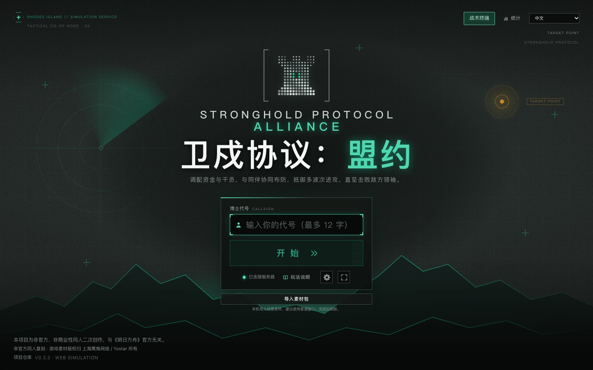
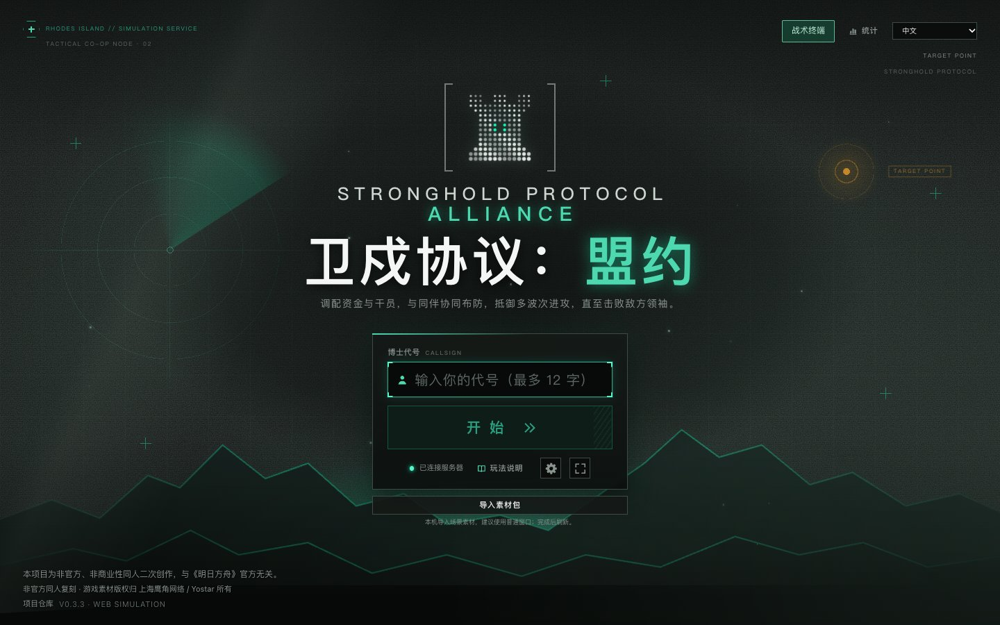
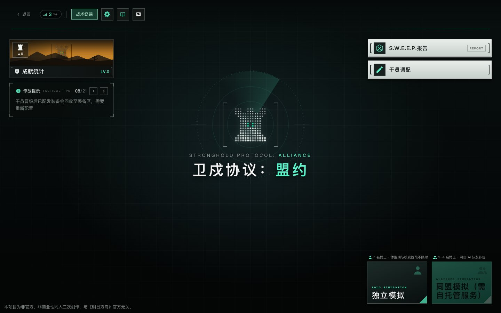
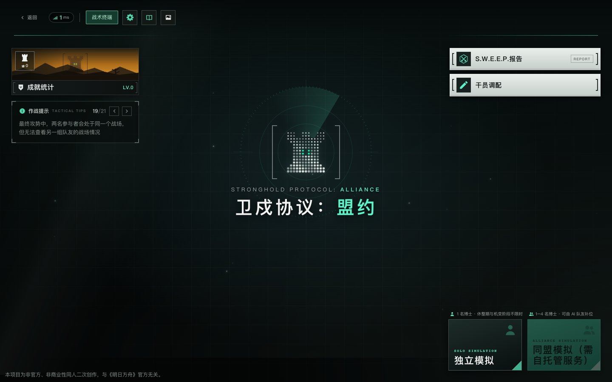

# Menu visual preview — v12 phase 1

[中文](V12-MENU-VISUALS.zh-CN.md)

This is a local development preview of **Stronghold Protocol: Alliance**, based on main `bce12084ca7ea0287129748453274663b288b576`. The v11 Public Site stays unchanged. Review and separate deployment approval are required.

## Try it

```sh
npm ci
npm --prefix upstream ci --omit=dev --ignore-scripts
npm run build
npm run server -- --port 4176
```

Open `http://127.0.0.1:4176/`. Move the mouse over the title, enter a callsign, start, and open the lobby settings. The original menus, language selector, terminal and lower-left attribution stay in place.

**Settings → Menu motion** switches between animated and static presentation. It is independent of audio. The existing **Quality** control also governs menu visuals:

| Quality | Title/default lobby | Existing generated lobby scenes |
| --- | --- | --- |
| Low | Static light, no particles or parallax | Static decoration, no particles; user video holds its current frame |
| Medium | Moving light, 8 upstream motes, no parallax | Existing scene, at most 8 visible motes |
| High | Moving light, 18 upstream motes, mouse-only parallax bounded to 7×5 px | Original scene and particle budget |

System reduced motion always overrides Animated. Switching tabs suspends decorative CSS animation, removes the new particles and unregisters pointer handlers. User-owned video pauses under static/reduced/low quality and resumes when allowed; existing upstream image first-frame handling is reused. New effects never cover a custom background or the night/frost/ember/calm scenes with another particle layer.

## Implementation and compatibility

- `personal/visuals*.mjs`, `visual-state.mjs`, `visual-policy.mjs` and `visuals.css` contain the extension. Build adapters fail closed if pinned upstream seams change; no tracked upstream source is edited.
- Reuse `HubScene`'s seeded mote data, markup and CSS. The generated build extracts one shared `HubMotes` component; it does not add a map engine, renderer or asset pack.
- Reuse original title/emblem and lobby entrance keyframes with shorter staging; navigation is synchronous. Button feedback is CSS only. No screenshot overlay or delayed transition blocks input.
- Added lighting uses CSS gradients and transform/opacity animation. Pointer movement schedules at most one pending frame; cleanup cancels it. No idle JavaScript frame loop, canvas/WebGL context, animation library or network resource is added.
- Settings live in `sp.pref.personal.visuals.v1`; quality keeps upstream `sp.pref.settings`. Missing/corrupt/unknown visual preference schemas use safe defaults. Storage denial produces an inline message while the selection remains active for the page. Match checkpoints, replay schemas and engine identity are unchanged.
- Game UI choreography and battlefield environment effects are **not part of this phase**. No combat rule, operator, route, collision, audio or map configuration changes.

## Verification and evidence

Run `npm test`, `npm run check:dist`, and `npm run test:browser` **serially**. `personal/visuals.browser.mjs` deliberately blocks external art and disables WebGL, exercises live reduced motion, persistence, hidden-page handling, synthetic user video, upstream themed scenes, six title/lobby route cycles, mobile landscape controls and denied storage. Its screenshots and JSON report are in `.cache/verification/` and the CI artifact. Existing suites continue to cover saves, replay/coach, audio and maps.

The CI workflow only builds/tests/uploads verification artifacts on push and pull request; it has no deployment step. Native Chrome/Safari results, exact tested commit, any limits and CI links are recorded in the PR acceptance report after CI passes. Browser automation is not a full nine-round player acceptance test or a long-duration GPU/thermal benchmark. Mobile evidence is emulation, not a phone test.

The review images below use only the upstream GPL procedural fallback, with third-party art blocked. No game asset is redistributed.

| Screen | v11 baseline | v12 phase 1 |
| --- | --- | --- |
| Title |  |  |
| Lobby |  |  |

Still images show composition, not motion. Local/CI regression also compares animated transforms at different times; the PR supplies native browser evidence.

## Rollback and rights

Before publication, closing this PR leaves production untouched. For a later approved release, keep v11's saved Site version/artifact, then roll back to that version or revert the visual commits and rebuild. The optional visual preference key can remain; v11 ignores it. No checkpoint migration or database rollback is required.

Upstream authorship, GPL-3.0-or-later, LICENSE, NOTICE and third-party rights remain in force. Original game assets continue to use existing external sources or user-owned local imports; this phase adds none. Codex assistance is attributed according to `AGENTS.md` without rewriting history.
