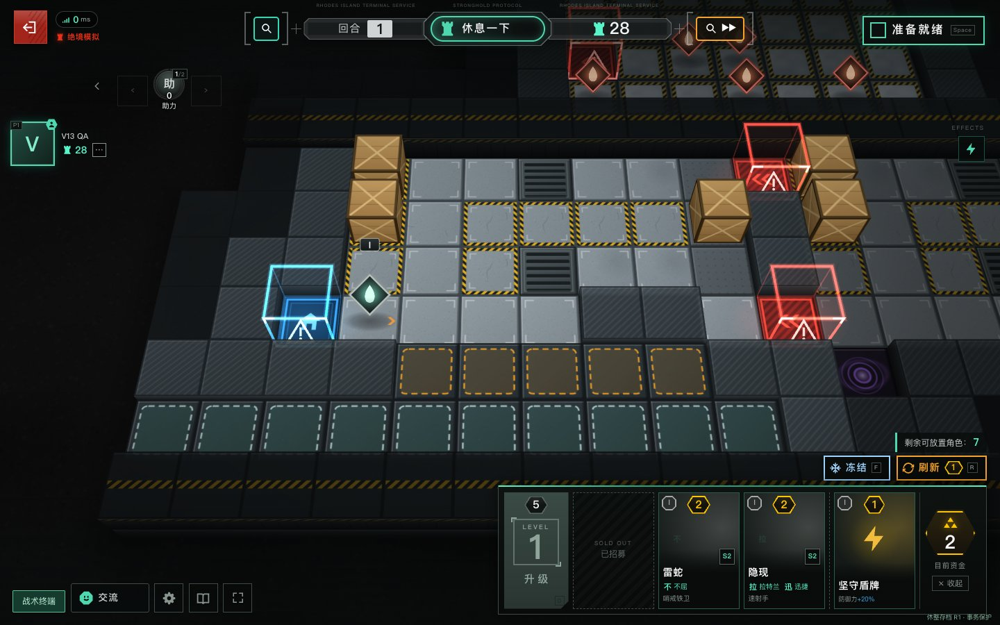
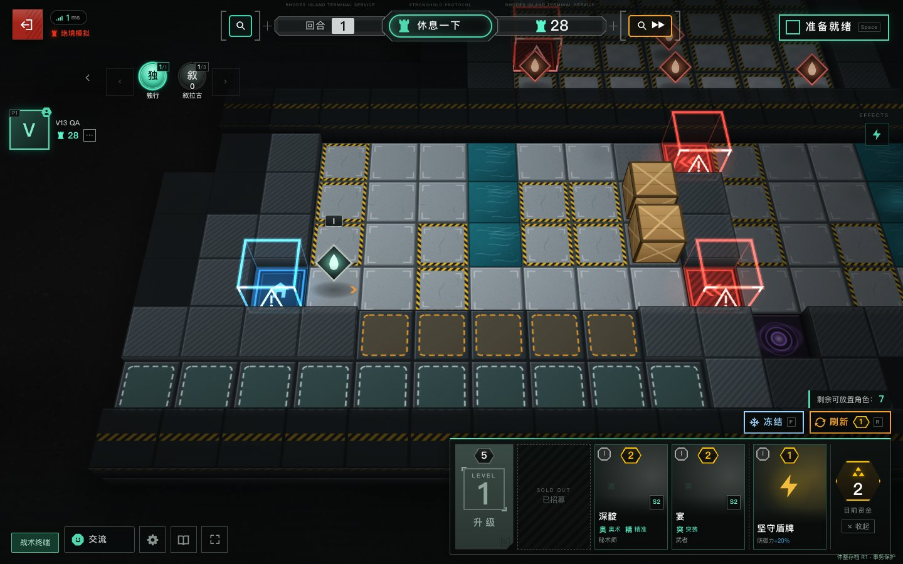
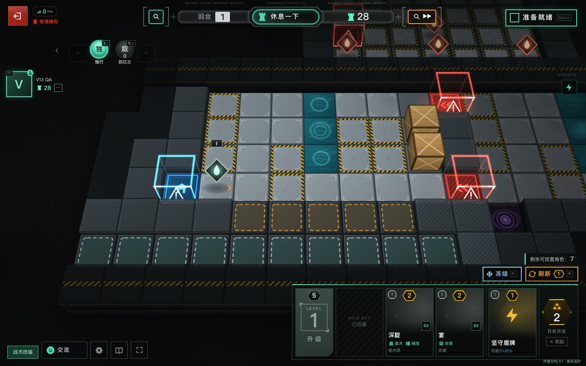

# Battlefield environment preview — v13 phase 1

[中文](V13-BATTLEFIELD-VISUALS.zh-CN.md)

**Stronghold Protocol: Alliance — Enhanced Edition**, based on main `8d4207ef42ab37ec1d3cff36db9b6c107ed0e3d5`. Phase 1 adds map-specific atmosphere to two existing maps. Sites v12 remains Public and unchanged. This branch requires review and separate deployment approval.

## Scope and reuse

| Original map | Phase 1 presentation | Assets and rules |
| --- | --- | --- |
| `act2autochess_m03`, Battlefield #07, Exhaust Grilles / 排气格栅 | Gentle light on actual vent tiles; slower, softer directional steam. Only the camera's focused field consumes the steam budget. | Reuses the upstream `TileField` smoke emitter and cached `fxAtlas` textures. No second emitter. |
| `act2autochess_m04`, Battlefield #08, Tidal Control / 涨潮控制 | Small expanding ripples anchored to actual deep-water tiles, over the original water glow. | Uses the existing camera projection, Pixi layer and ring texture; quads stay within each tile. |

Original stage selection, deployment legality, routes, coordinates, terrain effects and combat calculations are unchanged. The QA seeds (HARD 5 and 3) use the existing data-only challenge feature and original map pool; they do not unlock maps. Other maps receive no new weather profile. Phase 2 combat feedback and phase 3 map expansion are deferred for review.

The extension is in `personal/battlefield-*.mjs`. Small fail-closed build adapters wire it into the existing field ticker, terrain sprites and Three scene shader clock. No tracked upstream code, map data, renderer, Spine animation, skill effect, dependency or asset pack is replaced or added. Rendering happens below units, shadows and legal-placement highlights; the new container cannot receive input. No simulation event is sent by the atmosphere controller.

## Settings and lifecycle

**Settings → Environmental motion / 动态环境效果** reuses v12's `sp.pref.personal.visuals.v1`; quality retains upstream `sp.pref.settings`. No second settings system or save migration is introduced.

| Setting | Added geometry | Vent steam |
| --- | --- | --- |
| Low, Static, reduced motion, hidden page or completed battle | 0 | Hidden |
| Medium | At most 8 projected quads across the current field | At most 8 existing sprites, focused vent tiles only |
| High | At most 24 projected quads across the current field | At most 16 existing sprites, focused vent tiles only |
| Imported original 3D scene active | 0 additional quads | Original scene owns its atmosphere |

The selected single-player PREP views contain **2 vent quads** or **6 water quads** at High; the larger caps accommodate the original combined battle camera. The cosmetic clock pauses with these settings. Original leak flashes, camera movement, combat, damage and input clocks remain live. Tactical airflow indicators also remain upstream behavior; Static is not a pause button for gameplay information.

No extra RAF loop, timer, renderer, texture, render target, filter or WebGL context is created. Owned meshes are released on static/hidden/reduced settings, stage changes, WebGL loss, settlement and field teardown. Canvas context listeners and the shared preference subscription are removed on teardown. Pixi continues to own context restoration. Effect draw failures are contained. No-WebGL devices retain the upstream DOM fallback and can still play.

For optional imported original 3D art, existing materials/water shaders receive the same cosmetic clock, without duplicate overlay geometry. Existing importer, cache, scene-loader and Three recovery remain in place. Licensed full-scene imports are not required for these effects; this phase does not claim a new full original-art acceptance pass. The shader timing and duplicate-suppression contracts have targeted synthetic tests.

## Local preview and automated verification

```sh
npm ci
npm --prefix upstream ci --omit=dev --ignore-scripts
npm run build
node personal/battlefield-preview.mjs
```

Open `http://127.0.0.1:4183/?seed=5` (vents) or `?seed=3` (water). Use a dedicated test browser profile: this **localhost-only QA harness** selects a fixed-seed challenge in that origin's storage. Enter a callsign, Start, then use **LOCAL V13 QA → 准备真实对局**. The probe buys and deploys through normal worker messages. Its quality/motion buttons use the real shared settings. “战斗至 R2” runs the actual simulation through settlement; “测量静态/动态/静态” collects three short samples. Close the preview with Ctrl-C.

The preview is muted synchronously before client initialization, including the first Start gesture. You can then enable audio in Settings; preparing a match preserves that manual choice. This affects only the dedicated QA origin, preserves other audio preferences and does not change production audio defaults. Keep the native browser window visible during measurements: hidden-window samples are invalid.

The preview is a plain static host plus a bounded report sink, with no room server or asset proxy. QA modules and the seeded initialization script are excluded from `dist/` and the release archive. Run tests **serially**:

```sh
npm test
npm run check:dist
npm run test:browser
```

The new browser suite blocks external art and tests moving projected geometry, all quality tiers, Static, reduced motion, hidden-page release, real context loss/restoration, six resource toggle cycles, picking, normal purchase/deployment, R1 combat/settlement to R2 and route teardown. A separate no-WebGL context also reaches R2. Synthetic original-scene uniforms prove that freezing ambient shaders does not freeze leak-event timers. Existing suites cover saves/restoration, replay/coach, audio, importer and original maps. CI builds and tests on push/PR and only uploads artifacts; there is no production deployment step.

## Acceptance evidence and limits

Actual results, performance samples and browser versions are recorded in [the phase 1 acceptance report](V13-ACCEPTANCE.md). This is not a nine-round or multiplayer/Boss re-acceptance, a phone-device test or a long-duration thermal/leak benchmark.

| Map | Static | Animated |
| --- | --- | --- |
| Exhaust Grilles |  |  |
| Tidal Control |  |  |

Review images use only GPL procedural fallback graphics with external third-party art blocked. They show composition; time-separated vertex/opacity checks and native browser observation verify motion. Raw local/CI reports live in `.cache/verification/`.

## Rollback and rights

Closing the PR leaves v12 untouched. After any later approved publication, restore the retained v12 Site version, or revert these phase 1 commits and rebuild. Gameplay engine/data/adapter fingerprints and checkpoint/replay schemas are unchanged, so no save/database migration is needed. v12 understands the same optional visual preference key.

Original authorship, `LICENSE`, `NOTICE`, GPL-3.0-or-later and third-party rights remain intact. All effects reuse existing procedural textures; no third-party game asset is downloaded into the release, publicly rehosted or newly licensed. Original art stays on existing external sources or in user-owned imports. Actual Codex contributions retain the maintainer identity and the repository's verified co-author trailer.
